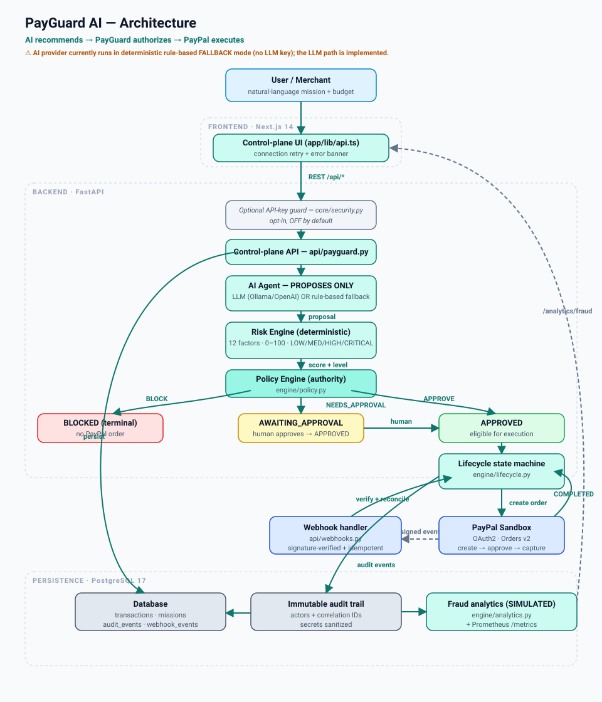

# PayGuard AI — Architecture

> **AI recommends → PayGuard authorizes → PayPal executes.**

PayGuard AI treats the AI agent as an *untrusted actor*: it can only **propose** a
purchase. Deterministic risk and policy engines decide whether that proposal is
auto-approved, needs human approval, or is blocked. Only authorized transactions
ever reach PayPal, and every step is recorded in an immutable audit trail.

The diagram above is a committed SVG. The editable source is
[`architecture.mmd`](./architecture.mmd) (Mermaid), which GitHub renders
natively.

> **Honest note on AI mode:** the LLM path (any OpenAI-compatible provider,
> including local Ollama) is fully implemented, but the current deployment runs
> the **deterministic rule-based fallback** because no LLM key is configured.
> The system is designed to work either way; the diagram labels this explicitly.

---

## Components and responsibilities

### Frontend — Next.js 14 (`frontend/app`)
The control-plane UI. Submits missions, shows the agent proposal, risk gauge,
policy decision, approval center, transactions, fraud-prevention and risk
analytics, and the audit trail. The API client (`app/lib/api.ts`) targets the
backend via `NEXT_PUBLIC_API_URL`, and the dashboard surfaces a connection
error with a one-time retry instead of silently showing empty data.

### Backend API — FastAPI (`backend/app/api/payguard.py`)
Orchestrates the full control-plane flow: mission → agent proposal → risk
evaluation → policy decision → persisted transaction, then execute/capture for
authorized transactions. Read-only endpoints expose transactions, a single
transaction, its audit timeline, and fraud analytics.

### Optional API-key guard (`backend/app/core/security.py`)
An **opt-in** guard on the four state-changing routes (mission create, approve,
execute, capture). Disabled by default (no `PAYGUARD_API_KEY` set) so the demo
stays open; when a key is configured it requires a constant-time-matched
`X-API-Key` header. The PayPal webhook is intentionally not guarded (it has its
own signature verification).

### AI Agent — proposes only (`backend/app/agent/agent.py`)
Turns a natural-language mission + budget into exactly one concrete purchase
proposal. Uses an OpenAI-compatible LLM when configured, otherwise a
deterministic rule-based fallback. The agent has **no** ability to approve,
capture, move money, or change risk/policy — adversarial mission text cannot
bypass the engines.

### Risk Engine — deterministic (`backend/app/engine/risk.py`)
Explainable, non-AI scoring. Twelve weighted factors (blocked/unknown merchant,
suspicious terms, budget burn, large amount, category, currency anomaly,
velocity, behavioral baseline, repeated failures, …) produce a 0–100 score and a
LOW / MEDIUM / HIGH / CRITICAL level with human-readable reasons.

### Policy Engine — the authority (`backend/app/engine/policy.py`)
Deterministic decision gate the AI cannot override. In order: non-positive or
over-budget amounts → **BLOCK**; HIGH/CRITICAL risk → **BLOCK**; amount at/above
the approval threshold → **NEEDS_APPROVAL**; MEDIUM risk → **NEEDS_APPROVAL**;
otherwise → **APPROVE**.

### Transaction lifecycle / state machine (`backend/app/engine/lifecycle.py`)
Validates every state change and records an audit event for each. Allowed path:
`APPROVED → PAYPAL_CREATED → COMPLETED`, with `→ FAILED` branches; `BLOCKED`,
`COMPLETED`, and `FAILED` are terminal. Invalid transitions are rejected and
audited.

### PayPal integration — Sandbox (`backend/app/payments/paypal.py`)
The only component with PayPal credentials. OAuth2 client-credentials token,
Orders v2 create (with `PayPal-Request-Id` idempotency and buyer approval URL)
and capture. A BLOCKED decision can never create a PayPal order.

### Webhook handler (`backend/app/api/webhooks.py` + `payments/paypal.py`)
Receives PayPal webhooks, verifies the signature through PayPal's verification
API before any processing, dedupes by event id (idempotent), and reconciles the
transaction through the audited state machine. Unverified payloads are rejected.

### Persistence — PostgreSQL 17 (`backend/app/models`)
Stores `transactions`, `missions`, `audit_events`, and `webhook_events`.

### Audit trail (`backend/app/engine/lifecycle.record_event`)
Every lifecycle transition is an immutable audit event with an actor
(`AI_AGENT`, `RISK_ENGINE`, `POLICY_ENGINE`, `USER`, `PAYPAL`,
`PAYPAL_WEBHOOK`, `RECONCILER`, `SYSTEM`) and a correlation ID tying the chain
together. Metadata is sanitized so secrets are never persisted.

### Fraud analytics — SIMULATED (`backend/app/engine/analytics.py`)
Read-only analytics derived from persisted decisions: simulated fraud attempts
blocked, blocked amount per currency, approval rate, risk distribution, and
decision breakdown. **Explicitly labeled SIMULATED** — a demonstration of the
control plane's value, not a claim of real money saved. Completed payments are
excluded from "blocked" figures.

### Observability (`backend/app/core/metrics.py`, `/metrics`)
Prometheus metrics for AI, risk, policy, approvals, PayPal, webhooks,
reconciliation, audit events, and HTTP latency.

---

## Security model (summary)
1. The AI only proposes; it holds no money-moving or policy-changing capability.
2. The risk and policy engines are deterministic, explainable, and authoritative.
3. Only the PayPal layer holds credentials; a BLOCK never creates an order.
4. Webhooks are signature-verified before processing; secrets are never logged.

Backed by an automated test suite (adversarial guardrail tests included).
